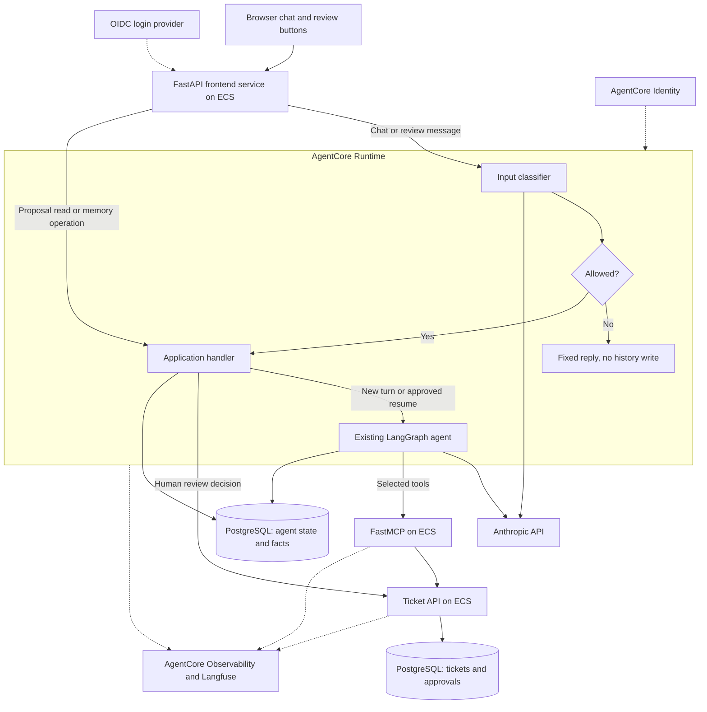

# Running this project on AWS

This is a proposed AWS deployment for the existing Helpdesk application.
It needs candidate review. No AWS resources were created or deployment tested.
The linked AWS documentation was checked on 2026-10-22.

## What stays the same

Today, chat, FastMCP, and the ticket API run in three local containers. SQLite
stores agent state separately from tickets and approvals. Models use the
Anthropic API, and Langfuse runs as a separate service.

The move to AWS should preserve the behavior that matters:

- The classifier screens input before it enters history.
- The LangGraph agent decides when to discover and call tools.
- The agent reaches tickets through MCP and the backend checks user permissions.
- A write pauses until the user explicitly approves it in a later message.
- Repeated approval or a retry cannot save the same change twice.

These boundaries are implemented in the
[agent service](backend/src/helpdesk/agent/service.py),
[approval middleware](backend/src/helpdesk/agent/approvals.py),
[storage module](backend/src/helpdesk/agent/storage.py), and
[MCP server](backend/src/helpdesk/mcp/server.py).

## Which AgentCore services to use

### Runtime: run the agent

Host our input classifier and LangGraph agent in AgentCore Runtime. It supports
LangGraph and external model providers, so we can keep direct Anthropic calls.
Add a Runtime adapter around the existing application and preserve its ReAct
loop, request limits, and approval checks.
[Runtime documentation](https://docs.aws.amazon.com/bedrock-agentcore/latest/devguide/agents-tools-runtime.html)

### Identity: handle identities and credentials

Use AgentCore Identity for workload identity and supported downstream
credentials. Users would sign in through an OIDC provider, such as Cognito.
The integration must carry their verified identity through to MCP and the
backend, where ticket permissions remain enforced.
[Identity documentation](https://docs.aws.amazon.com/bedrock-agentcore/latest/devguide/identity.html)

A service credential identifies the calling service. The backend also needs the
acting user's identity. Selecting and testing that delegation mechanism remains
an open task before deployment.

### Observability: monitor the deployment

Use AgentCore Observability for AWS monitoring and keep Langfuse for existing
traces, experiments, datasets, and scores. Configure OpenTelemetry instrumentation
and shared trace IDs across services. Verify that exports filter sensitive data
and count model usage only once.
[Observability documentation](https://docs.aws.amazon.com/bedrock-agentcore/latest/devguide/observability-configure.html)

### Gateway and Memory: optional additions

**Gateway** can connect existing MCP servers. Initially, keep our one FastMCP
service directly connected. Consider Gateway when integrations grow, after
checking that it preserves delegated access and model-selected discovery.
[MCP target documentation](https://docs.aws.amazon.com/bedrock-agentcore/latest/devguide/gateway-target-MCPservers.html)

**Memory** provides managed conversation and cross-session memory. Keep our
single operating-system fact in application storage initially, with its 30-day
expiry and deletion rules. Managed memory would need a separate compatibility
check; it cannot be assumed to replace exact checkpoints or approval records.
[Memory documentation](https://docs.aws.amazon.com/bedrock-agentcore/latest/devguide/memory.html)

Browser, Code Interpreter, and additional agents are unnecessary for this
workflow. The existing offline evaluations remain the quality check.

## Proposed architecture

All services below are proposed. Dotted arrows show login and monitoring links.

The thin FastAPI service serves the frontend and preserves its endpoints. MCP
and the ticket API run as separate private ECS services. The agent has no
ticket-database credentials.

Use RDS PostgreSQL for storage. The two database nodes can share one instance,
with separate schemas and roles for agent and backend data.

Chat and approval messages pass through the classifier. Proposal reads and
memory endpoints remain authenticated application operations without a model
call. They must never become model tools.

## What to verify on AWS

| Area | Evidence needed |
| --- | --- |
| Runtime | ARM64 build, healthy startup, JSON/SSE requests, and bounded errors |
| User access | No access to another user's session or forbidden tickets |
| Restart | Stop a paused Runtime session, then recover the same proposal and conversation |
| Approval | Concurrent approvals and a timeout after a committed write save one change |
| Storage | Checkpoints, tool results, interrupts, and recovery pass the protocol suite on PostgreSQL |
| Memory | Fact overwrite, 30-day expiry, and deletion keep their behavior |
| Tracing | Correlated spans, accurate available usage, and filtered exports |
| Operations | Region support, quotas, network access, database connections, latency, and estimated cost |

History and trace retention still need a policy. PII detection and redaction
remain unimplemented. Runtime isolation supports the security design, while
application code continues to enforce user and ticket permissions.

This draft was prepared with AI assistance. The candidate should review the
choices and tradeoffs before submission. It does not claim AWS deployment
validation or personal operating experience.
