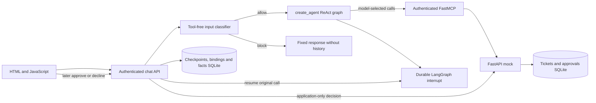

# IT Helpdesk agent

A local Helpdesk assistant that searches tickets, proposes a new ticket or a
comment, pauses for explicit user approval, and executes the exact approved
change at most once. It uses Claude Sonnet 5.5, LangChain `create_agent` backed
by LangGraph, an authenticated Python FastMCP server, a FastAPI mock, SQLite,
a plain HTML/JavaScript UI, and local Langfuse. The offline judge is Opus 5.5.

The conversational write path, cross-session device preference, browser review,
runtime mock faults and application containers are implemented. See the
[completion report](docs/COMPLETION.md) and [review fixes](docs/REVIEW_FIXES.md)
for measured verification and limits,
and the [assignment status](docs/ASSIGNMENT_STATUS.md) for remaining submission work.
AWS deployment is not required; `AGENTCORE.md` remains a separate deliverable.

## Quick start with containers

Install Docker with Compose, copy `.env.example` to `.env`, and replace the
credential placeholders. Supply a valid `ANTHROPIC_API_KEY`. Keep mock tokens,
MCP tokens and the mock service key distinct. The four user IDs in the example
match the seeded users. Provider calls use the paid Anthropic API.

```sh
cp .env.example .env
# Edit .env locally; never put credentials in chat or version control.
docker compose --env-file .env up --build -d --wait
```

Open [the chat](http://127.0.0.1:8000/), enter a seeded user ID and that user's
MCP bearer token, then Connect. The provider key never goes in the browser.
The mock initializes its eight seeded tickets only on first startup. Named
volumes preserve tickets, pending approvals, checkpoints and facts across restart.

```sh
docker compose --env-file .env ps
docker compose --env-file .env restart mock chat
docker compose --env-file .env down
```

`down` preserves data; `down -v` deletes the application's named volumes. Do not
use volume deletion as a normal restart. Only loopback ports 8000 (chat), 8001
(mock/operator API), and 8002 (MCP) are published. All three services run as a
non-root user from one locked image. The Docker context excludes credentials,
runtime data, Git history, reports and tests.

Langfuse has its own Compose file and database infrastructure:

```sh
uv run python scripts/init_langfuse.py
docker compose --env-file .env.langfuse -f compose.langfuse.yaml up -d
# Load both files when application tracing is enabled.
docker compose --env-file .env --env-file .env.langfuse up -d --wait
```

The application containers reach local Langfuse through `host.docker.internal`;
`LANGFUSE_CONTAINER_URL` can select the local `langfuse-web` network endpoint.
The host alias works with Docker Desktop. On native Linux a loopback-only host
listener may require explicitly connecting the containers to the local Langfuse
network. There is no cloud tracing fallback.

## Run without containers

Use Python 3.11+ and uv. Run from the checkout root:

```sh
uv sync --locked
uv run python -m helpdesk.mock.init_db
```

For an existing database use `--upgrade` instead of reseeding. Load `.env` in
each terminal, then start the three services:

```sh
set -a
. ./.env
set +a
uv run uvicorn helpdesk.mock.api:from_env --factory --host 127.0.0.1 --port 8001
# In a second configured terminal:
uv run uvicorn helpdesk.mcp.server:from_env --factory --host 127.0.0.1 --port 8002
# In a third configured terminal:
uv run uvicorn helpdesk.api:from_env --factory --host 127.0.0.1 --port 8000
```

The CLI supports the same session/approval flow:

```sh
uv run python -m helpdesk.agent.service --user user-001 --session demo --message "Read TKT-001"
uv run python -m helpdesk.agent.service --user user-001 --session demo --message "approve"
```

The second command is meaningful only after a proposal exists. This CLI is a
trusted developer interface; HTTP separately verifies the bearer credential
against the supplied user ID. `MODEL_PROVIDER` and `MODEL_NAME` select the model
through LangChain configuration. Only Anthropic is installed and evaluated;
another provider requires its integration and credentials.

## Architecture and trust boundaries



The outer LangGraph routes `guardrail -> agent | blocked` without a checkpointer.
Only accepted agent turns enter durable conversation history. The classifier
returns plain `0` or `1`, has no tools and stores nothing. Blocked requests use
one application-owned English reply; neither their text, intent nor static
reply enters the model history. Classification failure is a technical error.
PII detection is not implemented.

For a new retrieval turn the model runs before any MCP connection. It chooses
`discover_tools`, then `list_tickets`; a successful current-turn overview unlocks
search, details and proposal tools. Vague issues require clarification first.
The model never supplies identity, roles, credentials or session authority.
An interrupted call was already selected by the model: approval resumes that
call rather than asking another model to authorize it. Schema restoration and
live permission checks run again on resume.

The agent's ticket reads, proposal staging and mutations go exclusively through
MCP. The application uses a separate bounded HTTP client only for approval
lookup and human decisions. Those endpoints are never model-callable tools.
The HTTP app needs its mock credentials for that control path.

| Tool | Purpose |
| --- | --- |
| `list_tickets` | Permission-filtered paginated IDs, titles and statuses |
| `search_tickets` | Paginated literal keyword/ID search; OR matching without embeddings |
| `get_ticket` | Authorized status, description and comments |
| `create_ticket` | Propose a new internal ticket; execute only an exact approved ID |
| `add_comment` | Read the target first, then propose or execute its approved comment |

MCP schemas retain their backend approval contract. The model-facing write
schemas hide `approval_id`; application code injects it after review. Unknown
arguments are rejected. One changed-argument correction of the same tool is
allowed after `invalid_arguments`; repeated invalid arguments or other terminal
errors disable further tool use. Parallel writes are rejected. Tool data is
untrusted evidence and cannot override instructions or grant approval.

## Approval and recovery

1. The model selects a proposal using user-supplied issue details.
2. MCP saves the exact action in the mock without changing a ticket. The agent
   stores a user/session/call binding, and the tool node calls `interrupt`.
3. The reply and review panel show the exact proposal. The graph stops.
4. In a later message use `approve`, `I approve`, `decline`, or `I decline`, or
   click a review button. A button includes the displayed approval ID. Ambiguous
   acknowledgements and changes to the proposal do not authorize a write.
5. Application code verifies ownership and exact arguments, records the decision
   through the backend, and resumes using `Command(resume=...)` on the same thread.
6. Only the approved action receives its stored ID. Mutation and replayable
   result commit atomically in the mock. Decline invokes no execution call.

Review state survives both mock and chat restarts. If staging succeeded but the
process failed before its local binding or native pause, review lookup resumes
only the original checkpointed proposal node. The backend deduplicates its exact
action. No new model runs and no approved mutation executes during that lookup.
The restored proposal must be shown before a subsequent decision is accepted.
Temporary recovery errors leave the original checkpoint retryable. Repeated approval cannot
create a new action or duplicate a mutation. The backend rechecks current access
on decisions, execution and completed-action replay. An already approved
decision cannot be changed to decline; the UI permits only reconciliation then.
For a different action, decline while pending and request a fresh proposal.

Completion and write-failure receipts are application-owned and derived from
validated results. They do not add an extra model call or resend pre-approval
ticket context after a possible role change. An uncertain result never becomes
an invented success or rollback. A later explicit approve reconciles only the
same durable ID; the review endpoint can also confirm a previously unknown
committed result. The guarantee is one durable mutation per approved action,
not exactly-once network delivery.

## Memory and retention

Conversation checkpoints are scoped by a hash of the authenticated user ID and
session ID. Reusing another user's session name does not grant its history.
History and approval bindings remain until an operator removes the local data;
there is no automatic history/approval TTL or automatic summarization.

Across sessions, retain only one device preference: `operating_system`, with
values Windows, macOS or Linux. The application recognizes explicit first-person
English statements such as `I use Windows 11` or `My laptop runs Linux` after
input screening. It does not run an extraction LLM or save arbitrary facts.
Questions, quoted third-party claims, hypothetical statements and role claims
are excluded. This intentionally narrow extractor is not universal language or
PII understanding.

The last explicit assertion overwrites that user's fact and starts a 30-day TTL.
Reading does not refresh it. Expired facts are filtered and removed on access.
The fact is added transiently to the same user's model context in a new session;
it never grants permissions. Authenticated `GET /memory` inspects it and
`DELETE /memory` removes it. Deletion affects extracted facts, not existing chat
history or prior traces.

Model context has an approximate 8000-token input budget. Old turns drop as
whole groups without deleting SQLite history; current tool-call/result pairs
and provider signatures remain together. Old ticket evidence is hidden until a
fresh overview confirms access, including IDs in nested creation receipts and
comment results. No scratchpad or additional memory agent exists.

## Runtime failures and bounds

Only an operator with `X-Mock-Service-Key` can configure the running mock. The
browser token and the model's tools cannot change fault settings. After loading
`.env`, for example:

```sh
curl -X PUT http://127.0.0.1:8001/admin/failures \
  -H "X-Mock-Service-Key: $MOCK_SERVICE_KEY" -H "Content-Type: application/json" \
  -d '{"mode":"rate_limit","target":"read","remaining":2,"retry_after_seconds":0.2}'
```

Modes are `off`, `rate_limit`, `server_error`, `slow`, and `committed_timeout`.
`target` selects `any`, `read`, or `write`. A finite `remaining` counter makes
recovery reproducible. `slow` uses `delay_seconds`; `committed_timeout` commits
an approved write, then replaces its response with an unknown-outcome timeout.
It does not affect proposal staging. `GET /admin/failures` inspects the counter;
PUT `{"mode":"off"}` disables it. Configuration resets on mock restart.

Authorization runs before fault injection. The backend client makes at most
three suitable attempts with exponential backoff and honors Retry-After within
a ten-second operation deadline. The MCP client allows twelve seconds so the
backend's deadline response can arrive. Typed MCP timeouts become safe tool
errors, without private RPC text. Writes retry only using their durable ID.
The main agent has six model calls/six tools per request and a 60-second deadline.
Provider calls have a 30-second timeout and two SDK retries.

Sonnet 5.5 uses adaptive thinking, medium effort and 1024 output tokens; sampling
parameters are omitted. The one-token guardrail uses low effort and tool-free
`between_tools`. Only guardrail/judge refusals allow one Opus 4.8 reserve; invalid
outputs and transport errors never switch models. The judge uses Opus 5.5 with
2048 output tokens. See the [Sonnet migration guide](https://platform.claude.com/docs/en/models/sonnet-5-5/migration-guide).

## HTTP and frontend

`POST /chat` accepts user ID, session ID, message and an optional approval ID.
`POST /chat/stream` emits only answer `text_delta`, `done`, or terminal `error`
events. Thinking and structured tool payloads never go into that stream.
Model text is buffered until the final message is validated: an earlier text
block can still be followed by a tool call. Only fragments belonging to the
final answer are then sent; their concatenation exactly equals `done.reply`.
This delays the first visible fragment until generation completes. It does not
provide live provider-token delivery. No extra generation is added, and native
proposal/approval receipts remain application-owned.
A failed or partial stream is not retried automatically or marked complete.

The page uses pinned, locally vendored Deep Chat with plain JavaScript. It sends
only the newest message and keeps credentials in page memory. Completed tool
names/outcomes use a separate user-bound request summary; proposal data uses
`GET /chat/sessions/{session_id}/approval`. Reconnecting the same session restores
its proposal. Review values render as text, and decisions bind the exact ID.
Tool outcomes distinguish pending, completed, declined and error.

## Verification and local Langfuse

```sh
uv run python -m helpdesk.evals --mode protocol
node --test frontend/tests/*.test.mjs
uv run --env-file .env --env-file .env.langfuse python -m helpdesk.evaluation \
  --dataset evals/completion-datasets.json
```

The protocol command runs correctness tests and maps P01–P20/F01–F09 to actual
results, including four review regression groups R01–R04. Native completion
experiments on the pre-review revision covered 17 cases: creation, comments,
decline, restart, duplicate approval, uncertain and failed writes, runtime rate
limits/timeouts, memory isolation and scope/injection controls. A separate Opus
judge assesses groundedness, helpfulness, scope adherence, instruction adherence
and clarity. Code checks enforce actual database effects and review behavior.
Those paid provider experiments were not rerun after the review fixes.
Historical datasets and failures remain unchanged; the new dataset has its own
`helpdesk-completion` namespace. AI-assisted labels, inspected regressions and
same-family judging are limitations, not independent human ground truth.

Every chat request has a correlated trace with screening, model settings and
available usage, MCP calls/results, authorization, approval, retry attempts,
latency and errors. Native model experiments use `sdk-experiment`; correctness
checks use `protocol-tests`; application requests use `development`. Logical
auxiliary spans do not duplicate per-generation usage. We mask configured
credentials, omit raw thinking and exception text, and do not invent unavailable
provider HTTP attempt counts or billed cost. Use the failed tool/approval phase
and its backend attempts to debug a run. See [observability](docs/OBSERVABILITY.md)
and [measured results](evals/results/latest.md).

## Continuous integration

[GitHub Actions](.github/workflows/ci.yml) runs Python/protocol checks,
JavaScript tests and a Docker image build on pull requests, pushes to `main`,
and manual dispatch. It uses locked dependencies, no provider/Langfuse secrets,
and preserves failure logs and reports as seven-day artifacts. Paid model
evaluations remain separate. See [CI setup and limits](docs/CI.md).
The workflow starts running after it is pushed to GitHub; branch protection
must be configured separately if checks should block merging.

## Tradeoffs and remaining work

Python, FastAPI/Pydantic and the small SQLite mock keep boundaries inspectable.
`create_agent` supplies the ReAct loop; a supervisor or another specialist agent
would add no required capability. The separate MCP/HTTP mock boundary makes
permissions and failure handling testable. One worker per service and serialized
chat requests are deliberate local-assignment limits. Do not claim multi-worker
coordination, production OAuth, synonym/semantic search or broad prompt-injection
resistance from this implementation.

PII detection/redaction is explicitly deferred. User/tool content can reach the
external provider, SQLite history and traces. Credential masking and safe errors
are not general PII protection. Follow-up work should handle relevant PII before
model calls, storage, trace export and fact extraction.

Still required for submission: the AWS AgentCore design and diagram, the
candidate's own reviewed design/AI-use conclusions, and final submission evidence.
AI assistance contributed implementation, tests, research and documentation;
recorded checks and preserved failures describe verification, not the candidate's
personal experience. No AWS deployment was performed. Broader fact extraction,
history cleanup, independent human eval labels and production auth are future
improvements rather than implemented features.

## Layout

Python code is under `backend/src/helpdesk/` with separate `agent/`, `mcp/` and
`mock/` boundaries. Tests are in `backend/tests/`; browser assets and stream/review
tests are in `frontend/`. Schemas and fixtures are in `data/`; ignored local
files are in `data/runtime/`. One root `pyproject.toml` and `uv.lock` define the
Python project. Docs, original assignment and evidence are in `docs/`; eval
catalogs and immutable run reports are in `evals/`. The vendored component's
license is retained in `frontend/vendor/deep-chat.LICENSE`.
