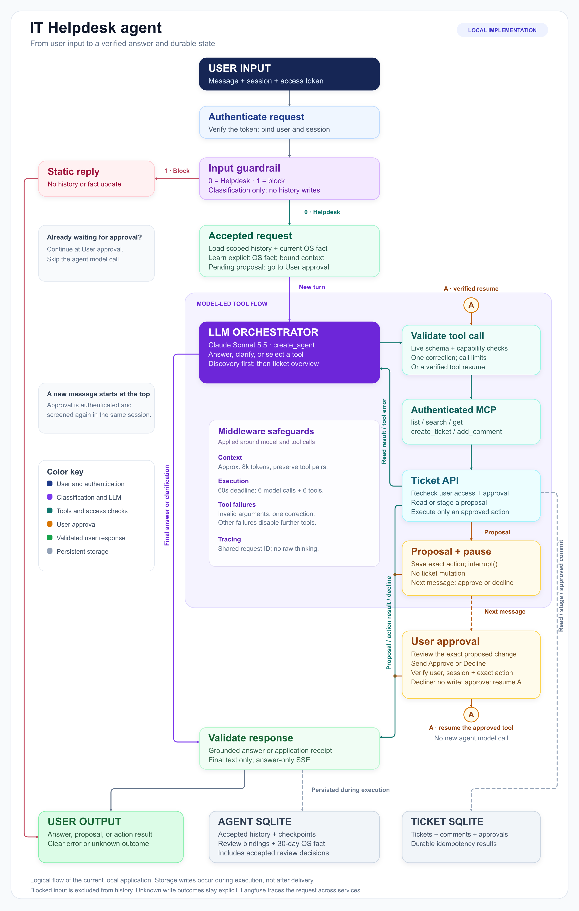

# IT Helpdesk agent

A local assistant for finding support tickets, checking their status, and
preparing new tickets or comments. Before saving a change, it shows the exact
proposal and waits for approval in a later message. Repeated approval saves
that change only once.

## Quick setup instructions

### Start the application

You need Docker with Compose and an Anthropic API key. Model calls incur API
charges. The application runs locally without an AWS account, and tracing is
off by default.

```sh
cp .env.example .env
```

Replace these placeholders in `.env`:

| Setting | Value |
| --- | --- |
| `ANTHROPIC_API_KEY` | Your Anthropic API key |
| `MCP_USER_TOKENS` | Random tokens mapped to the four demo user IDs |
| `MOCK_USER_TOKENS` | A separate set of random tokens for the same users |
| `MOCK_SERVICE_KEY` | A separate random service key |

Keep the example's JSON format, where each token maps to a user ID. Use different
credentials for MCP, mock users, and the service. Keep real credentials out of Git.

```sh
docker compose --env-file .env up --build -d --wait
```

Open `http://127.0.0.1:8000/`. Enter a configured user ID, such as `user-001`,
and its token from `MCP_USER_TOKENS`, then click **Connect**. The Anthropic API
key belongs in the server configuration.

Ask about an IT problem, then request a ticket or comment. Review the proposal
and choose **Approve** or **Decline**. The mock contains four users and eight
tickets, including restricted tickets for testing access controls.

```sh
# Check health, restart without clearing data, or stop the application.
docker compose --env-file .env ps
docker compose --env-file .env restart mock chat
docker compose --env-file .env down
```

Named volumes preserve tickets, history, user facts, and pending approvals.
**`docker compose down -v` deletes the application's stored data.**

### Add local Langfuse

Use Python with uv to generate local Langfuse credentials and start tracing:

```sh
uv run python scripts/init_langfuse.py
docker compose --env-file .env.langfuse -f compose.langfuse.yaml up -d
docker compose --env-file .env --env-file .env.langfuse up -d --wait
```

Open `http://127.0.0.1:3000/` and sign in with the credentials in `.env.langfuse`.
Wait for the UI to become available before running model evaluations. The setup
script preserves an existing credentials file.

On Docker Desktop, application containers reach Langfuse through
`host.docker.internal`. On native Linux, you may need to connect the containers
to the Langfuse network and set a reachable `LANGFUSE_CONTAINER_URL`, because a
loopback-only listener may be unreachable. Tracing has no cloud fallback.

<details>
<summary>Run the Python services without containers</summary>

Use Python 3.11 or newer and uv. Containers and CI use Python 3.13.
Run `uv sync --locked` from the repository root, then load `.env` in each terminal:

```sh
set -a
. ./.env
set +a
```

Initialize the mock once, using the service's database path. For an existing
database, use `--upgrade` instead of reseeding:

```sh
uv run python -m helpdesk.mock.init_db --database "$MOCK_DATABASE"
```

Start each service in its own configured terminal:

```sh
# Terminal 1
uv run uvicorn helpdesk.mock.api:from_env --factory --host 127.0.0.1 --port 8001

# Terminal 2
uv run uvicorn helpdesk.mcp.server:from_env --factory --host 127.0.0.1 --port 8002

# Terminal 3
uv run uvicorn helpdesk.api:from_env --factory --host 127.0.0.1 --port 8000
```

The developer CLI uses the same session and approval flow. It trusts local
configuration; the HTTP interface verifies the caller's bearer credential.

```sh
uv run python -m helpdesk.agent.service \
  --user user-001 --session demo --message "Find tickets about VPN issues"
```

</details>

## Architecture overview

One Dockerfile builds a shared application image. `compose.yaml` runs three
services from that image:

| Service | Local port | Responsibility |
| --- | --- | --- |
| Chat | `8000` | Browser page, authenticated chat API, and agent |
| MCP | `8002` | Python FastMCP tools at `/mcp` |
| Mock | `8001` | FastAPI ticket service, permissions, and approval records |

The agent accesses tickets through MCP and the mock HTTP API. The chat
application also reads approval state and records user decisions through a
separate application-only path. The model cannot call those approval endpoints.

Agent checkpoints, proposal bindings, and user facts share one SQLite database.
The mock stores tickets and approvals in another. Langfuse runs in a separate
Compose project with PostgreSQL, ClickHouse, Redis, MinIO, web, and worker
services, so rebuilding the application does not require restarting tracing.



`POST /chat` and `POST /chat/stream` accept `user_id`, `session_id`, `message`,
and an optional `approval_id`. Other authenticated endpoints restore proposals,
show completed tool calls, and inspect or delete the user's stored fact.

## Agent design

### Frameworks and models

We considered a manual LangGraph workflow, `create_react_agent`, and a supervisor.
We chose LangChain `create_agent`, backed by LangGraph, for the ReAct loop and
persistent execution state. One agent covers the Helpdesk workflow. A small
outer graph routes screened input to the agent or a fixed refusal.

| Role | Model and settings |
| --- | --- |
| Main agent | Claude Sonnet 5.5 through Anthropic; adaptive thinking, high effort, 1,536 tokens shared by thinking and answer text |
| Input guardrail | Claude Sonnet 5.5; low effort, tool-free `between_tools`, one output token |
| Offline answer judge | Claude Opus 5.5; adaptive thinking, medium effort, 2,048 output tokens |

Development started with Sonnet 5 and moved to Sonnet 5.5. Model selection
followed project requirements and integration results; we did not benchmark
competing providers. Classifier and judge calls can fall back once to Opus 4.8
after a provider refusal. Invalid output and transport failures do not trigger
fallback, and the main agent never switches models automatically.

`MODEL_PROVIDER` and `MODEL_NAME` are configurable. Anthropic is the only installed
and evaluated integration. Another provider requires its package and testing.

Adaptive thinking uses an effort level rather than a fixed reasoning-token
allocation. The main agent has a shared 1,536-token thinking/text limit and
keeps user-facing answers concise. The classifier and judge retain their own
smaller-effort settings.

Before proposing a ticket, the assistant assesses whether another support
engineer could understand the problem and triage it. It considers relevant
symptoms, expected behavior, scope, impact, timing and remedies already tried.
If a missing user observation would materially help, it asks one focused
question and waits. This is not a mandatory questionnaire: clear reports can
proceed, and unknown optional details stay unknown. Descriptions contain user
facts, not invented explanations or missing-information placeholders.

### Tool selection

The model runs before any MCP connection on each fresh turn. It can answer or
ask for missing details without accessing tickets. When it needs ticket data,
it selects `discover_tools`, a local utility that discovers authorized MCP tools.
A successful `list_tickets` call then unlocks search, details, and proposals.
The application rebuilds available tools each turn.

The system prompt is one static string literal. Middleware never interpolates
values into it or appends runtime system blocks. Current tool schemas carry
available capabilities. A remembered user preference is a separate data block
in the current user message sent to the model; that temporary enrichment is
not saved into the conversation checkpoint and never grants authority.

The agent distinguishes a request to find an existing record from a report of a
new problem. If no credible match exists and the affected system or functional
area and symptom are clear, it proposes a new ticket. Optional diagnostics,
such as an exact OS version, do not block a proposal. An unclear problem gets
one focused question; a lookup-only request does not trigger a new proposal.

<a id="approval-and-recovery"></a>

### State and user approval

1. The model selects a write tool and supplies the proposed ticket or comment.
2. MCP stages the proposal. The application binds it to the user and session,
   then pauses with LangGraph `interrupt`. The ticket remains unchanged.
3. The page shows the exact proposal. A later message must explicitly approve
   or decline it, using a button or text such as `approve` or `decline`.
4. Application code verifies the owner, session, action, and arguments, records
   the decision, and resumes with `Command(resume=...)`.
5. The backend commits the approved change and its result in one transaction.
   Repeated approval returns the saved result; decline performs no write.

Only application code can inject a verified approval ID. The model cannot
approve its own proposal. Changed arguments require a new proposal; an approved
action can be reconciled but cannot later be declined.

Confirmation messages show the exact ticket or comment in plain language and
ask whether to proceed. The review card uses readable labels; operation names,
schema keys and approval IDs stay out of ordinary chat. Technical tool names
remain visible in the separate activity panel for inspection.
The confirmation card comes first. Tool activity is collapsed by default so
diagnostics do not compete with the user's decision.

Pending state survives restarts. If the process stops after staging but before
saving the pause, recovery replays the original proposal node. It restores the
proposal without a new agent model call or an approved write. The user must see
the restored proposal before submitting another decision.

A timeout after dispatch can leave the outcome uncertain. Reconciliation reuses
the same durable action ID and reports an unknown outcome if it cannot establish
the result. A missing response never counts as proof that the write failed.

New tickets receive sequential IDs: `1`, `2`, `3`, and so on. SQLite allocates
the number in the same transaction as the approved ticket and its saved result.
The counter survives restarts; proposals, declines and repeated confirmations
do not consume numbers. Existing ticket IDs remain valid.

### Memory and retention

| Data | Storage and retention |
| --- | --- |
| Conversation | SQLite checkpoints, isolated by authenticated user and session; no automatic expiry |
| Proposal bindings | Agent SQLite records and backend approval records; survive restarts with no automatic expiry |
| Cross-session fact | One `operating_system` value in agent SQLite: Windows, macOS, or Linux; expires after 30 days |

The fact extractor accepts explicit first-person English OS statements from
allowed messages. A new assertion replaces the old value and resets its expiry;
reading it does not extend retention. Questions, hypothetical statements, quotes
about other people, and role claims are excluded. Facts never grant permissions.

`GET /memory` returns the authenticated user's fact. `DELETE /memory` removes
that fact, while old conversations and traces retain their own records. Expired
facts are removed on access. Session names alone never authorize history access.

The model receives an approximately 8,000-token context. To fit that budget,
the application omits whole older turns while preserving stored history,
current tool-call/result pairs, and provider signatures. Historical ticket
content stays hidden until a fresh overview confirms access. Neutral assistant
markers preserve turn boundaries while that content is hidden, so old user
messages cannot merge into the latest request. These markers are transient;
they do not change stored conversations. Memory does not include automatic
summarization or a scratchpad.

## Tool design

Tool names describe Helpdesk actions. Each description explains when to use the
tool, its arguments, pagination, proposal behavior, and error handling. Runtime
instructions use general rules, without fixture IDs or expected eval answers.

| Tool | Purpose |
| --- | --- |
| `list_tickets` | List accessible ticket IDs, titles, and statuses with pagination |
| `search_tickets` | Search by exact ID or literal keywords with pagination |
| `get_ticket` | Read an authorized ticket's status, description, and comments |
| `create_ticket` | Propose a new internal ticket, then execute the exact approved action |
| `add_comment` | Propose a comment after reading its target, then execute after approval |

Keyword search uses OR matching. It has no embeddings or automatic synonyms.
The backend filters permissions before counting or paginating results and gives
the same normal response for missing and inaccessible tickets.

### Authentication and permissions

FastMCP verifies the caller's user-specific bearer token and current Helpdesk
membership. It authenticates to the mock with two separate credentials:

- `X-Mock-Service-Key` identifies the calling service.
- A mock bearer token identifies the verified user.

MCP maps credentials instead of forwarding its incoming token. The application
supplies trusted session context through `X-Session-Id`; model arguments cannot
set the acting user. The backend checks current permissions on reads, approval
decisions, and writes. Users without Helpdesk access receive no ticket tools.

### Errors and recovery

MCP tool failures set `isError: true` and return a compact payload:

```json
{
  "is_error": true,
  "code": "access_denied",
  "message": "This user does not have Helpdesk access.",
  "is_retryable": false
}
```

Rate limits may include `retry_after_seconds`. Write failures may include an
`outcome` of `not_applied` or `unknown`. Request IDs and attempt counts stay in
traces. Discovery failures use JSON-RPC errors, and HTTP authentication rejects
invalid MCP credentials before tool execution.

The application validates arguments against the discovered schema. After
`invalid_arguments`, the model may correct that tool's arguments once. Another
invalid call or a different terminal error stops tool execution for the turn.
`is_retryable` describes transport recovery, which has separate limits:

| Boundary | Limit |
| --- | --- |
| Mock HTTP calls | Up to three suitable attempts within 10 seconds, with backoff and bounded `Retry-After` |
| MCP call | 12 seconds, allowing the backend's typed error to arrive |
| User request | 60 seconds, at most six agent model calls and six tool calls |
| Provider call | 30-second timeout and two SDK retries, subject to the request deadline |

Write retries reuse the durable action ID so a lost response cannot create
a duplicate change.

## Quality

### Cases and metrics

Correctness tests combine synthetic model responses with the real graph, MCP,
mock, and databases. They cover permissions, pagination, argument correction,
approval, decline, restart recovery, duplicate prevention, uncertain writes,
and user isolation. Real-model evaluations measure tool selection and answers
separately:

| Dataset | Cases | Coverage |
| --- | ---: | --- |
| Earlier read-only regression set | 54 | 21 tool-selection, 11 answer-quality, and 22 adversarial/control cases |
| Completion set | 28 | 13 tool/workflow, 11 answer/memory/conversation/intake, and four adversarial/control cases |

Use the completion set for the current approval and write workflow. The earlier
set preserves the read-only contract from that stage of development.

Adversarial cases cover authority spoofing, instruction injection, encoded
requests, multilingual overrides, and gradual diversion. Legitimate IT requests
check for false refusals. Completion cases cover creation, comments, decline,
restart, repeated approval, failed or uncertain writes, runtime faults, and
cross-session memory.

Code graders inspect tool calls and database changes. An offline Opus judge
scores groundedness, helpfulness, scope adherence, instruction adherence, and
clarity. It has no application tools or authority to approve writes.

We report code pass, judge availability and pass, joint pass, guardrail errors,
false blocks and false allows, model/tool counts, available token usage, and
latency p50/p95. Judge usage is separate. Missing results remain failures or
unavailable measurements.

### Latest recorded results

| Check | Result | Scope and date |
| --- | --- | --- |
| Python correctness tests | 357 passed | Includes exact confirmation content, a static system-prompt invariant, memory isolation, sequential IDs and history boundaries, 2026-10-24 |
| Protocol requirements | 33/33 passed | Mapped requirements and regressions, 2026-10-23 |
| JavaScript tests | 26/26 passed | Readable restored confirmations, live streams, progressive rendering, approval binding and UI recovery, 2026-10-24 |
| Confirmation wording evals | 3/3 code, judge, and joint pass; 6/6 screening decisions correct | Ticket creation, comment addition and decline with natural confirmation text; one trial per case, 2026-10-24 |
| Static-prompt integration evals | 7/7 code, judge, and joint pass; 15/15 screening decisions correct | Cross-session memory, user isolation, dynamic tools, rate limits, intake, approved ticket and comment writes; one trial per case, 2026-10-24 |
| Earlier targeted conversation and intake evals | 10/10 code, judge, and joint pass; 19/19 screening decisions correct | Useful clarification, factual descriptions, clear-report controls, task changes, lookup, approval and creation; high effort, one trial per case, 2026-10-23 |
| Earlier targeted intent and approval evals | 7/7 code, judge, and joint pass | Two earlier runs covering new-ticket intent, lookup-only, clarification, approve and decline, 2026-10-23 |
| Real-model completion | 17/17 code, judge, and joint pass | Earlier source revision, 2026-10-21 |
| Completion input screening | 30/30 correct; no false blocks or false allows | Same historical run |
| Completion agent latency | p50 9.20s; p95 16.92s | Same local experiment; not a production benchmark |

The latest confirmation run covered C01, C02 and C03 in completion dataset v6.
It verified the revised messages through real approved writes and decline in
isolated databases. The earlier static-prompt run covered C01, C02, C08, C09, C10, C22 and C28 in
completion dataset v6. It checked that dynamic tool schemas and transient
user-memory data remain usable without modifying the system message. Source
and prompt hashes are recorded with the results.

The earlier intake run used Sonnet 5.5 with high effort and a shared 1,536-token
thinking/text limit, plus an Opus 5.5 judge. It covered C01, C18 through C20,
C22, C23 and C25 through C28 in completion dataset v6. Per-turn checks prevent
an earlier tool call from satisfying a later browse request. Earlier attempts
exposed a missing targeted search, a stale account follow-up, and unnecessary
technical clarification; those failed results remain recorded. The full
completion and adversarial suites have not been rerun on this revision.
Historical scores and a small targeted rerun do not establish repeated-run
reliability or full current model quality.

The new intake pair checks that an ambiguous dashboard discrepancy prompts a
useful question, then becomes a faithful pending ticket after the user supplies
the expected and observed values, affected scope and timing. Clear incident
controls check that optional specifications do not become mandatory questions.

A browser check repeated the reported task switch, including the original
misspelled browse request. The final answer listed ten accessible tickets with
IDs, titles, statuses and pagination, without returning to the account intake.
This browser check performed no ticket writes.

A later browser review covered 21 linked steps and exposed unresolved failures:
pending proposals ignore natural corrections and some confirmation phrases;
after a read failure the agent can contradict a previously completed write;
and missing assignment or schedule fields can become unsupported negative
claims. These failures are not covered by the seven passing targeted cases.
They remain open; the browser transcript and screenshots are retained with
the evaluation results.

`evals/results/` contains reports, failed trials, and source/prompt/dataset hashes.
Local Langfuse also holds the native datasets and experiment scores.

Run correctness checks with Python/uv and Node.js 22:

```sh
uv sync --locked
HELPDESK_TRACING_ENABLED=false uv run python -m helpdesk.evals --mode protocol
node --test frontend/tests/*.test.mjs
```

With Anthropic and local Langfuse configured, run the paid completion evaluation:

```sh
uv run --env-file .env --env-file .env.langfuse python -m helpdesk.evaluation \
  --dataset evals/completion-datasets.json
```

### Guardrails and evaluation gaps

The input guardrail uses Claude Sonnet 5.5, just like the main agent. It makes
a separate, tool-free call before the message reaches the agent, with low effort
and a one-token limit. Its only valid outputs are `0` for Helpdesk and `1` for
blocked requests.

Blocked requests receive a fixed reply. Their text, intent, reply, and
placeholders never enter history or facts. Invalid or unavailable classification
returns a technical error. A later valid message can proceed normally.
Authorization, argument validation, approval checks, execution limits, and
handling ticket content as untrusted data remain separate controls.

Eval labels and judge anchors were AI-assisted. Cases examined during tuning
are regression tests, not unseen evidence. The judge shares a model family with
the agent and may share its errors. A finite attack set cannot prove general
resistance to injection.

Independent human labels, external security testing, load tests, and multi-worker
validation are still missing. Most evaluations use in-process HTTP; separate
container smoke tests exercised actual services and provider calls.

### Try controlled failures

An operator can enable faults with the mock service key. Load `.env`, then make
the next two eligible reads return a rate limit:

```sh
set -a
. ./.env
set +a
curl -X PUT http://127.0.0.1:8001/admin/failures \
  -H "X-Mock-Service-Key: $MOCK_SERVICE_KEY" \
  -H "Content-Type: application/json" \
  -d '{"mode":"rate_limit","target":"read","remaining":2,"retry_after_seconds":0.2}'
```

Available modes are `off`, `rate_limit`, `server_error`, `slow`, and
`committed_timeout`. Set `target` to `read`, `write`, or `any`, and `remaining`
to the number of faults. The `slow` mode takes `delay_seconds`.

`committed_timeout` saves an approved write, then reports an unknown outcome;
it leaves proposal staging unaffected. GET `/admin/failures` shows the settings.
PUT `{"mode":"off"}` disables faults, and restart resets the switch. Authorization
runs before fault injection. Browser users and model tools cannot enable faults.

## Observability

A shared request ID connects guardrail, model, MCP, backend, and approval activity.
Langfuse records model settings, available token usage, tool arguments/results,
latency, retries, errors, approval decisions, and write outcomes.

| Langfuse environment | Traffic |
| --- | --- |
| `development` | Application requests, rooted at `helpdesk.request` |
| `protocol-tests` | Deterministic correctness checks |
| `sdk-experiment` | Real-model experiments and judge runs |

To debug a bad run:

1. Find the request trace and check whether the guardrail allowed, blocked, or
   failed to classify the input.
2. Inspect the model's calls and the tools available at each step.
3. Check argument validation, backend permissions, errors, and retry attempts.
4. For a write, compare the proposal, user decision, and saved outcome.
   Reconcile an unknown outcome using the same action ID.
5. Compare the final answer with successful tool results. Treat a partial
   stream as incomplete, even if the browser received some text.

Traces mask credentials and exclude raw thinking, exception text, and blocked
message text. Parent spans do not count generation tokens again. Provider SDK
retry counts and billed cost remain unavailable where the integration does not
expose them.

**PII detection and redaction are not implemented.** User and ticket content can
reach Anthropic, SQLite, and traces. Credential masking does not provide general
PII protection. History and traces also need explicit retention and deletion rules.

## Key technical decisions and why

| Decision | Reason and tradeoff |
| --- | --- |
| SQLite | Keeps local setup simple and supports atomic writes; limits concurrency |
| Separate MCP and mock services | Makes tool access and ticket permissions testable at their boundaries; adds service calls |
| Discovery and overview before details | Establishes current tool availability and accessible tickets; adds a round trip |
| Approval enforced in code | Keeps write authority with the user; requires persistent pause and recovery state |
| Live answer SSE | Shows text during generation; an interrupted answer can remain partially visible |
| One OS fact across sessions | Meets the memory requirement with limited storage; recognizes only narrow English statements |

Answer text streams as the model generates it. Thinking and tool-call chunks
stay private. The model is instructed to finish tool use before writing its
answer. If it streams narration before selecting another tool, a `text_reset`
event discards that draft from completion validation; the next text replaces
it in the browser. Until completion, visible text remains provisional. A failed
or truncated generation has no success event. Application-owned proposals and
write receipts use verified data and appear once that action is ready.
The browser renders received fragments word by word, with a 40 ms pause between
words, so batched text does not appear all at once. This animation also applies to
application-owned replies; it is separate from the model's real SSE stream.
Reduced-motion preferences and hidden tabs skip the animation.

The application runs one worker per service and serializes chat requests. Search
remains lexical, and the AWS work is a deployment design that has not been tested
in an AWS account.

## Engineering standards

### AI solution architecture

We applied selected recommendations from Anthropic's *Building effective agents*,
*Writing effective tools for agents*, and *Demystifying evals for AI agents*.
These are design guidelines, not a certification standard.

| Principle | How we applied it |
| --- | --- |
| Keep the design simple | One agent, five domain tools, SQLite, and a thin frontend |
| Separate workflow from judgment | Code controls identity, approval, and persistence; the model clarifies requests and selects tools |
| Make tools easy to use | Action-based names, explicit schemas, clear descriptions, paginated results, and concise errors |
| Bound autonomy | Deadlines and call limits, with user approval before ticket changes |
| Evaluate actual outcomes | Inspect tool calls and database changes alongside answer quality and traces |

LangGraph supplies state and interruption support. Integration tests verify
those behaviors, including failures and recovery. Independent human grading
and repeated trials on unseen cases remain work to do.

### Service boundaries and contracts

The design uses three microservice principles: focused responsibilities,
explicit contracts, and ownership of data. Chat owns orchestration, MCP owns
the tool interface, and the mock owns ticket rules and mutations. Ticket access
crosses an API boundary; the agent never queries the ticket database directly.

Pydantic models and MCP schemas define contracts and validate incoming data.
Each service authenticates its caller, while the ticket backend enforces the
acting user's permissions. Separate containers provide health checks and
configuration through environment variables.

The services share one repository, image, and release cycle. This assignment
needs clear boundaries, but not independent release pipelines, a service mesh,
a message broker, or distributed transactions.

### Function design and code organization

Functions and modules separate orchestration, guardrails, transport, ticket rules,
storage, and HTTP handling. Names describe their purpose: `snake_case` for
functions and variables, `PascalCase` for classes. Prompts live in dedicated
modules.

Python docstrings use NumPy style, with a short summary and relevant
`Parameters`, `Returns`, `Raises`, or `Notes` sections. Comments explain reasons
and constraints. Single blank lines separate logical steps, and long calls wrap
for readability. All project text is in English.

Boundary models and type annotations document contracts; annotations remain
incomplete and have no static checking gate. SQL uses bound parameters.
Synchronous storage calls run outside the event loop to avoid blocking async
checkpoint commits.

| Location | Contents |
| --- | --- |
| `backend/src/helpdesk/` | Python application |
| `backend/tests/` | Backend tests |
| `frontend/` | Browser assets and tests |
| `data/` | Schema and fixtures |
| `data/runtime/` | Ignored local databases |

One root `pyproject.toml` and `uv.lock` define the Python environment.

### Reliability and idempotency

Timeouts, bounded retries, backoff, and request deadlines limit the cost of
failure. Authentication and validation errors stop execution rather than
triggering repeated calls. Approval and recovery state persist across restarts.

The backend commits each ticket change and its reusable result in one transaction
under a durable action ID. This guarantees at-most-once mutation for that approved
action, including retries after a lost response. It does not guarantee exactly-once
network delivery or merge two separately approved actions.

Regression tests cover decline, repeated approval, staging crashes, lost write
responses, and SQLite writer contention. Multi-worker coordination requires
separate storage and concurrency validation.

### Security and reproducible delivery

Least privilege governs service and user access. Credentials establish identity;
messages, memory, and trace metadata cannot grant rights. Backend checks protect
both reads and writes, while the input classifier screens unwanted requests.
The classifier alone is not a security boundary.

Containers run as a non-root user and expose loopback ports. Secrets come from
environment configuration, and the browser holds credentials in page memory.
Vendored browser code retains its license.

GitHub Actions runs Python/protocol checks, JavaScript tests, and a Docker build
on pull requests, pushes to `main`, and manual runs. Dependencies are locked,
actions use pinned commits, repository permissions are read-only, and jobs need
no provider secrets. Logs and reports remain available as seven-day artifacts.
Paid model evaluations run separately.

Review and CI findings led to regressions for revoked ticket data in history,
tool narration in the answer stream, crashes after staging, lost reconciliation
responses, and SQLite calls blocking checkpoint commits. Historical failures
remain recoverable in Git; model trial reports remain in `evals/results/`.

Linting, static type checks, branch protection, production OAuth, and automatic
history cleanup are not configured. A successful Docker build checks packaging;
runtime behavior needs separate verification.

## How AI tools were used

AI assistance covered API research, design comparisons, code and prompt drafts,
fixtures, evaluations, debugging, documentation, and diagrams. Separate research
tasks explored ticket search, project layout, and provider logging. An Astra
code review identified four defects, which were fixed with regression tests.

I directed the scenario, stack, model choices, tools, approval flow, guardrail
policy, and memory scope. We revised generated work through discussion and
checked it with tests and experiments. AI-generated labels and reviews are not
independent human validation. This README was also edited with AI assistance.

## What would change with more time

- Rerun paid evaluations on the final revision, with repeated trials and fresh
  cases reviewed independently of prompt development.
- Add PII handling before model calls, storage, tracing, and memory extraction,
  with retention and deletion rules for history and traces.
- Replace demo tokens with verified login and delegated access, while keeping
  ticket permissions and approval checks in backend code.
- Verify PostgreSQL checkpoints and coordination before adding workers.
- Test synonyms or hybrid retrieval when a larger ticket dataset warrants them.
- Add lint/type checks, load tests, and broader failure and security testing.
- Validate the AWS design in an account, including recovery, identity propagation,
  networking, quotas, and cost.

## Candidate perspective

I wanted a small Helpdesk assistant whose actions I could inspect and explain.
I took part in the design step by step, from the stack and tool contracts to
permissions, approval, memory, and tracing. Keeping the scope close to the
assignment helped make those decisions concrete.

The model should understand the request, ask for missing details, and choose
tools. Access must still match the user's rights, and a proposed change must
wait for that user's approval. I would keep these boundaries and durable
idempotency in a larger system.

Python, a framework-backed ReAct agent, SQLite, and a simple frontend kept the
implementation manageable. I would revisit storage and search when measured
concurrency and retrieval needs justified more complexity.

I wanted the demo to expose failures as well as successful runs. Restricted
tickets, controllable faults, adversarial inputs, and traces made that possible.
The recorded results support specific claims, but a finite test set does not
prove production readiness. My next priority would be repeated model evaluations
on the final revision with independently reviewed cases.

This perspective was drafted with AI from our development discussions.
The decisions and limitations are mine to review and explain; AI assistance
and passing tests do not replace that responsibility.
