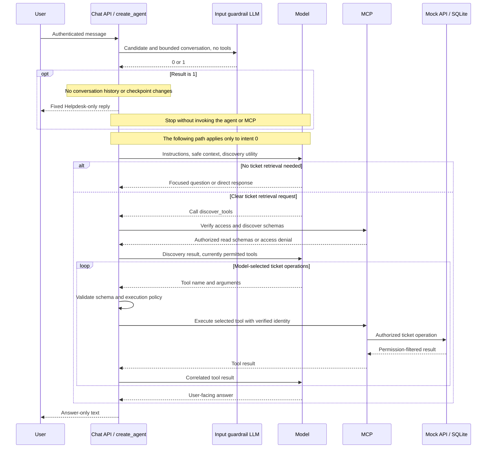

# IT Helpdesk agent assignment

The current implementation contains an authenticated mock ticket API and five
MCP tools: list, search, read, create ticket, and add comment. Ticket writes require
persistent user approval and are safe to retry with the same approval ID.
A read-only ReAct agent now uses `langchain.agents.create_agent`, MCPAdapter,
and SQLite conversation checkpoints. Authenticated chat HTTP endpoints support ordinary replies and answer-only SSE
streaming. Local Langfuse tracing and a one-command eval runner are configured.
Conversational approval, cross-session facts, and the runtime mock failure
switch remain incomplete. The agent and primary guardrail now use Sonnet 5.5;
the offline judge uses Opus 5.5. The latest full frozen v5 run passed 53/54
code/judge cases. One follow-up encountered an Anthropic connection error;
two unchanged repeats passed separately. The guardrail made 57/58 expected
decisions, all classified decisions correct. Screening and judging may invoke
Opus 4.8 once after a provider refusal; the main agent never switches models.
The current correctness suite passed 290 Python tests and eight frontend stream
tests. See the [measured results](evals/results/latest.md) for preserved failures
and incomplete telemetry coverage, and the
[assignment and prompt audit](docs/ASSIGNMENT_STATUS.md) for remaining work.

## Repository layout

```text
backend/
  src/helpdesk/
    mock/            Mock HTTP API, ticket storage, and schemas
    mcp/             MCP tools, authentication, and backend HTTP client
    agent/           create_agent setup, context preparation, service, and local CLI
    api.py           Authenticated chat and answer-only SSE endpoints
    errors.py        Minimal public error definitions
    telemetry.py     Local Langfuse spans and credential masking
    evals.py         Original requirement coverage and protocol runner
    evaluation.py    Native dataset experiments and offline answer judge
  tests/             Backend and MCP integration tests
frontend/            HTML/JavaScript chat, pinned Deep Chat bundle, stream tests
data/
  schema.sql         Users and tickets
  approval_schema.sql  Durable proposals and completed write results
  seed.json          Reproducible users and tickets
  runtime/           Generated local databases, ignored by Git
docs/
  PLAN.md            Agreed scope, decisions, and progress
  MCP.md             Tool contracts, authentication, and approval flow
  ERRORS.md          Failure categories, retries, and recovery decisions
  OBSERVABILITY.md   Recorded fields, local Langfuse setup, privacy, and limits
  EVALUATION.md      Case matrix, graders, run commands, and known gaps
  ASSIGNMENT_STATUS.md  Source assignment audit and prompt review
  assignment/        Original assignment document
pyproject.toml       One Python project's dependencies and test configuration
uv.lock              Locked dependencies
evals/               Case catalog and recorded evaluation results
compose.langfuse.yaml  Local Langfuse infrastructure
scripts/             Local credential initialization and cached evaluation regrading
.env.example         Configuration template without real credentials
AGENTS.md            AI assistant development rules
```

The backend uses an editable `src` package, installed by `uv sync`. No manual
`PYTHONPATH` configuration or frontend build pipeline is required.

## Local setup

Use Python 3.11 or later and uv. Run commands from the repository root.

```sh
uv sync --locked
```

On a fresh checkout, initialize the database once:

```sh
uv run python -m helpdesk.mock.init_db
```

If the database already exists from the read-only implementation, add approval
storage without changing its users, tickets, or comments:

```sh
uv run python -m helpdesk.mock.init_db --upgrade
```

Initialization refuses to overwrite existing tables. `--database PATH` selects a
different database; upgrade requires that database to exist.

Copy `.env.example` to `.env` and replace every credential placeholder with a
locally generated random value. Keep `.env` out of version control.

- `MOCK_SERVICE_KEY` authenticates MCP to the mock.
- `MOCK_USER_TOKENS` maps mock-specific bearer tokens to user IDs.
- `MCP_USER_TOKENS` maps separate MCP bearer tokens to user IDs.
- `MOCK_API_URL` points MCP to the mock API.

These are local demo credentials, not an OAuth deployment. MCP tokens are never
forwarded to the mock; MCP selects a different, user-bound upstream credential.
No model argument can select a user, role, credential, or conversation ID.

## Start the mock and MCP server

Load the configuration in each terminal:

```sh
set -a
. ./.env
set +a
```

Start the mock in the first terminal:

```sh
uv run uvicorn helpdesk.mock.api:from_env --factory --host 127.0.0.1 --port 8001
```

Start MCP in the second terminal:

```sh
uv run uvicorn helpdesk.mcp.server:from_env --factory --host 127.0.0.1 --port 8002
```

Connect an MCP client to `http://127.0.0.1:8002/mcp` with an MCP bearer token.
The client application supplies `X-Session-Id` for write proposals and execution.
The mock's interactive HTTP documentation is at `http://127.0.0.1:8001/docs`.
See [MCP contracts and approval flow](docs/MCP.md) for usage and limitations.

## Run the read-only agent

Start the mock and MCP server as above. In a third terminal, load `.env` and
provide a real `ANTHROPIC_API_KEY`. `MODEL_NAME` defaults to the selected
`claude-sonnet-5-5`. A real run uses the paid provider API; development tests never
call it.

```sh
uv run python -m helpdesk.agent.service --user user-001 --session demo-1 --message "Read TKT-001"
```

The CLI prints a JSON object with `reply` and the current turn's `tool_calls`.
An error prints the minimal public error object and exits with status 1.
Repeating `--user` and `--session` restores the conversation after process restart.
Different users or session IDs have separate histories. `AGENT_DATABASE` defaults
to `data/runtime/agent.sqlite3`, separate from the mock ticket database.

This is a trusted local developer CLI. Selecting `--user` is not web user
authentication; the HTTP handler below separately verifies a bearer credential
and requires its user ID to match the request body. The model cannot choose the user or token.
Each run gets a separate user-bound MCP HTTP client and fresh permission checks.
Only authorized `list_tickets`, `search_tickets`, and `get_ticket` schemas can be
loaded into the agent through its local discovery utility. An invented write
call cannot reach a write tool or stage a proposal.
Each model call also receives the current effective tool names. Discovery
distinguishes the mandatory overview from tools unlocked after it succeeds;
an old availability result cannot justify skipping a requested detail lookup.

After authentication, a separate tool-free LLM input guardrail runs before
the agent and before checkpointing the candidate message. It returns plain
`0` (Helpdesk) or `1` (unrelated or unsafe), without JSON or a response
schema. The Sonnet 5.5 classifier uses `thinking={"type":"between_tools"}`,
low effort, and `max_tokens=1`. With no tools this disables up-front thinking;
the Opus 4.8 reserve uses `disabled` instead. Agent settings are unchanged. Recent
user-scoped conversational context is bounded to six entries of 600 characters,
with historical ticket evidence hidden until access is rechecked. This adds one
primary provider call per message. A provider `refusal` permits one Opus 4.8
reserve invocation with the same prompt and one-token output cap. Invalid output
or a transport failure never switches models. Exhausted recovery remains a
technical error, without an invented classification. The current synthetic evaluation measures sample
classification accuracy and request latency; it does not establish production
attack resistance. See the [measured results](evals/results/latest.md).

`guardrail.input` records the decision code, intent, allow/block outcome, attempt
list, prompt hash and duration in Langfuse. Each `guardrail.attempt` generation
records its actual model, settings, stop reason and usage; the logical parent
span has no duplicate token usage. Failed
classification is a separate error outcome without a fabricated intent. Parent
request metadata mirrors the routing decision; input classified as blocked is
not logged. A false allow can still reach normal history and traces; the
intermediate M13 regression demonstrated this despite a correct main-agent refusal.
The main system prompt explains that screening grants no permissions and uses
the same fixed reply as a fallback if a purely unrelated/unsafe request slips
through. It still handles legitimate IT work in mixed benign requests and
ignores instructions in ticket content. See the
[current migration trace evidence](docs/evidence/sonnet-5-5-migration.json).

Guardrail logic lives in `backend/src/helpdesk/agent/guardrails/input.py`;
its instructions live in that package's own `prompts.py`. The main agent's
instructions remain in `backend/src/helpdesk/agent/prompts.py`.

Every blocked request receives exactly:

> I can help with IT Helpdesk requests only. Please describe your IT issue or provide a ticket reference.

The guardrail only classifies. A blocked turn leaves conversation history and
checkpoints unchanged: neither its text, intent, static reply, nor a placeholder
is stored for later model input. Tracing records the decision and a blocked
input status without rejected text. The raw candidate is sent
transiently to the classifier provider; this does not assert provider-side
deletion. A subsequent legitimate message can continue normally after a restart.
Classification errors stop execution with `guardrail_unavailable`; they neither
reach MCP nor classify the user as malicious. Vague IT issues pass for clarification,
and technical MCP/API errors keep their specific explanations. The gate does not
replace backend authorization, approval enforcement, or PII detection. Previously
stored history and historical evaluation artifacts are not rewritten.

The main agent model runs before any MCP connection. Initially it sees only the local
`discover_tools` utility. Its decision to call that utility triggers live MCP
authorization and schema discovery. After success, `list_tickets` is offered;
a successful model-selected overview enables search and direct reads for that
turn. The application never prefetches ticket data or manufactures assistant
calls. Clarifications, social acknowledgements, and out-of-scope refusals can
finish without connecting to MCP. Every new user turn requires new discovery;
no ticket schemas or permissions are reused from earlier turns.

For a new issue, the model asks one focused question before retrieval if the
affected system or meaningful symptom is missing. Explicit ticket references
and clear browsing/filter requests already define a retrieval task. After a
successful search with no similar accessible ticket, it reports the absence
and asks a relevant clarification rather than inventing a match. These semantic
decisions are prompt-guided and evaluated with real-model cases.
The overview is paginated and contains only accessible IDs, titles, and statuses.
It is a small-fixture strategy; a partial page is not the entire catalog.



The service routes each request through an outer LangGraph StateGraph:
`START -> guardrail -> agent | blocked -> END`. `workflow.py` disables its
checkpointer so rejected input never enters durable state. The `agent` node
invokes the ready-made `create_agent` ReAct graph with the verified user's
SQLite thread and an explicit root checkpoint namespace. Its ReAct loop is
not manually assembled; there is no supervisor. See the
[exported graphs](docs/diagrams/agent-graph.md).
`MODEL_PROVIDER` defaults to `anthropic`; model
creation uses LangChain's provider selector. Other providers require their own
installed integration and credentials; only Anthropic is configured here.

A run has a 60-second deadline, at most six model calls, and at most six tool
calls, including discovery, all selected by the model. Membership checks during discovery and MCP
execution are additional authorization work within the same deadline. Provider calls have a 30-second timeout and at most two SDK retries; the MCP
client keeps its existing bounded retry policy. Tool arguments are validated
against the discovered MCP JSON schema before execution, including required
fields, types, bounds, and unknown keys. After `invalid_arguments`, the model
gets one correction of the same tool with changed arguments. Repeated invalid
arguments or other tool errors block further tool execution; the model can
explain the failure or ask the user for missing information. This correction
uses the existing model/tool budgets and is separate from network retries. A
separate graph-step limit is a fallback. One service instance serializes runs;
multiple workers sharing the same conversation database are not supported yet.

Before each model call, `agent/context.py` prepares a transient context through
`wrap_model_call` and `request.override(messages=...)`. This avoids destructive
`before_model` history updates. The approximate input budget is 8000 tokens,
including system instructions and current tool schemas, independent of the
1024-token output limit. It is a local estimate, not Anthropic's exact billed token
count. Old exchanges are dropped only at user-turn boundaries; the full current
turn and its tool calls/results remain together. If the current turn itself
cannot fit, the agent returns `context_limit_exceeded` instead of silently
truncating it.

Tool JSON formatting whitespace is compacted without changing values, and
application-only artifacts are excluded from the transient message objects.
Artifacts were already excluded from Anthropic's model-visible content by the
SDK; their removal is not claimed as additional provider token savings. Required
tool IDs, thinking blocks, signatures, and meaningful text are retained. Complete
history and original tool results stay in SQLite. Old turns outside the model
view are not automatically recalled; cross-session facts remain a separate step.
No extra summarization model call is introduced.

Historical ticket evidence and derived assistant replies are hidden from the
first model input until a fresh model-selected overview confirms access to all
historical ticket IDs. User-supplied references remain available. A partial
listing does not authorize unseen tickets. This transient restriction avoids
replaying data after a role change, without making hidden ticket RPCs or
changing the checkpoint. Interrupted reads receive an explicit error result
before the next user message to preserve the stored tool-call protocol.

The installed integration is `MCPAdapter` from `langchain[mcp]`, currently beta.
The older `langchain-mcp-adapters` failed an import check with our MCP SDK and is
not a dependency. Compatible package versions are locked in `uv.lock` and the
real HTTP/authentication integration is covered by deterministic tests.

Conversation checkpoints are short-term history, not cross-session user facts.
Fact extraction, retention/cleanup policy, and
approval-enabled writes are separate upcoming steps. The model's refusal and
retrieval quality have recorded real-model evaluations with exact versions. One trial is
insufficient to establish reliability; subjective quality still needs review.

## Local tracing and evaluations

```sh
uv run python scripts/init_langfuse.py
docker compose --env-file .env.langfuse -f compose.langfuse.yaml up -d
uv run python -m helpdesk.evals
```

Langfuse is available at http://localhost:3000. Generated local credentials live
in the ignored `.env.langfuse`; load it in each application terminal to enable
tracing. The Compose file does not receive the Anthropic API key. Tracing is
disabled by default without explicit application configuration.

The original requirement bank contains 53 cases: 20 protocol groups, 24 real-model tasks, and
nine explicitly pending capabilities. The default run records missing provider
credentials as blocked and does not substitute a fake model. Protocol tests do
use prepared responses to verify mechanics, not Sonnet decision quality.

See [observability setup and fields](docs/OBSERVABILITY.md),
[evaluation method and commands](docs/EVALUATION.md), and
[the latest measured report](evals/results/latest.md).
In Langfuse Tracing, filter **Environment = sdk-experiment** for model evaluation
runs and **Environment = protocol-tests** for correctness checks. New protocol
runs have one `eval.protocol_run` tree containing per-test operations. Historical
records remain unchanged; ordinary application requests use `development`.
See [trace separation](docs/OBSERVABILITY.md#separate-application-evaluation-and-protocol-traces).

Native datasets v4 contain 52 model cases, including three new clarification
scenarios and updated expectations for discovery and vague issue reports. Dataset versions and source
trajectories remain separate from later cached rejudging.

References: [agent factory](https://docs.langchain.com/oss/python/langchain/agents),
[MCP integration](https://docs.langchain.com/oss/python/langchain/mcp), and
[SQLite checkpointer](https://github.com/langchain-ai/langgraph/tree/main/libs/checkpoint-sqlite),
and [transient context preparation](https://docs.langchain.com/oss/python/langchain/context-engineering).

## Stream answers to chat

Run the chat API in a third terminal with the same environment:

```sh
uv run uvicorn helpdesk.api:from_env --factory --host 127.0.0.1 --port 8000
```

Both `POST /chat` and `POST /chat/stream` accept `user_id`, `session_id`, and
`message`. Authenticate with that user's configured MCP bearer token through
`Authorization: Bearer ...`. The token determines the actor; a different user ID
in the body is rejected before streaming begins. No mock service key reaches the
browser. This is the local demo credential scheme, not OAuth.

`POST /chat` returns the collected reply and internal tool results.
`POST /chat/stream` uses Server-Sent Events and exposes only answer text:

```text
event: text_delta
data: {"text":"The ticket "}

event: text_delta
data: {"text":"is open."}

event: done
data: {"reply":"The ticket is open.","request_id":"completed-request-uuid"}
```

The chat concatenates `text_delta.data.text` and treats `done` as confirmed
completion. The final event also includes an opaque request ID for the separate
tool-activity lookup. Thinking blocks and tool calls/arguments/results
are excluded from this public stream. Tool results remain internal for history
and future observability. The prompt asks the agent to call tools silently.

A failed run ends with `event: error` carrying the minimal public error object,
without `done`. A partial answer preceding an error is incomplete and must not
be presented as successful. Authentication and input errors detected before
streaming return an ordinary non-2xx JSON response. Once SSE headers are sent,
a run failure is represented by the terminal error event within the HTTP 200
stream. Do not automatically resubmit a conversation when the connection breaks.

Use browser `fetch` with a POST body and bearer header, reading its response
stream; native `EventSource` does not support this POST/auth-header interface.
Open `http://127.0.0.1:8000/` for the HTML/JavaScript Deep Chat interface.
Enter the configured user ID and that user's MCP bearer token; never enter a
provider API key. Credentials remain in page memory. Only the newest input is
sent; browser message history is never replayed to the model. The server remains
the authority for identity, session isolation, and stored conversation context.

The tool panel uses authenticated `GET /chat/requests/{request_id}/tools` after
completion. It returns names and statuses only, bound to the authenticated user.
The last 128 completed summaries are kept in process memory and disappear on
restart; these diagnostics contain no prompts, intent records, arguments, or
ticket payloads and are not conversation memory. Failed/incomplete requests
have no completed summary. The UI marks partial replies incomplete and does
not automatically replay them. Approval controls remain pending until the
conversational write path is connected. See [frontend details](frontend/README.md).

For the local CLI, add `--stream` to print answer-only events as JSON lines.

### Selected Sonnet settings

- Model: `claude-sonnet-5-5`, direct Anthropic API.
- For a key spanning multiple workspaces, set `ANTHROPIC_WORKSPACE_ID` in the
  ignored `.env`; the SDK sends it as `anthropic-workspace-id`. A key scoped to
  one workspace can omit this setting. Keep real keys out of `.env.example`.
  See [Anthropic authentication](https://platform.claude.com/docs/en/manage-claude/authentication).
- Thinking: `{"type":"adaptive"}`; effort: `medium`.
- `max_tokens`: 1024 per model call, including thinking and visible output.
- Sampling parameters (`temperature`, `top_p`, `top_k`): omitted.
- Provider timeout: 30 seconds, SDK retries: two (at most three attempts). Whole-run deadline: 60 seconds.
- Agent budgets: six logical model calls and six tool calls per user message.
  SDK retries occur inside a logical call and remain bounded by the run deadline.
  A failed stream is not automatically restarted after text has begun, avoiding
  duplicate answer fragments.

Medium effort is an initial latency/cost tradeoff for short Helpdesk interactions,
not an evaluated optimum. Truncated provider output fails explicitly rather than
reporting completion. Real-model evaluations use the paid provider API. See the measured report
for the exact model and prompt versions; older Sonnet 5 results do not validate
a subsequent Sonnet 5.5 migration.

Sources: [Sonnet 5.5 migration](https://platform.claude.com/docs/en/models/sonnet-5-5/migration-guide),
[thinking and effort](https://platform.claude.com/docs/en/build-with-claude/prompt-engineering/prompting-claude-sonnet-5-5),
[LangChain streaming](https://docs.langchain.com/oss/python/langchain/streaming),
and [FastAPI SSE](https://fastapi.tiangolo.com/tutorial/server-sent-events/).

## Permissions

Employees can search, read, and propose comments on the six `internal` tickets.
Support can access all eight tickets, including the two `restricted` ones.
Users without Helpdesk access cannot discover or call the MCP tools.
The MCP boundary checks live Helpdesk membership; the mock independently checks
current roles and ticket visibility. Support cannot read or decide another
user's pending approvals.

Mock requests require both `X-Mock-Service-Key` and a mock user bearer token.
Missing or invalid credentials return `401`; no Helpdesk membership returns `403`.
Missing and inaccessible tickets share a non-disclosing `404` response.
Search excludes restricted data before ranking, counts, and pagination.

## Known limitation: PII detection

Personally identifiable information (PII) detection and redaction are not
implemented in this assignment. They are explicitly deferred follow-up work.
User messages and ticket/tool content may therefore contain personal data that
reaches the external model or persistent conversation history.

A follow-up implementation should detect and redact relevant PII before model
calls and before saving or exporting logs, traces, and extracted user facts.
Existing credential handling and safe error responses do not provide general
PII detection. No PII filtering coverage or validation is claimed.

## Verification

```sh
uv run pytest -q
```

Tests use independent temporary databases, HTTP requests to the mock, and the
actual authenticated, stateless MCP HTTP stack in-process. They cover permissions,
exact ID and keyword search, pagination, credential rejection, identity spoofing, durable approval,
decline, changed arguments, concurrent retries, transaction rollback, lost write
responses, bounded retries, deadlines, and non-destructive schema upgrades.
Agent tests use a scripted model with the real `create_agent`, MCPAdapter, and
authenticated MCP HTTP stack. They verify direct reads, search/read sequences,
minimal errors, blocked writes, call limits, deadlines, history restart and
isolation, and changed permissions. Scripted decisions do not demonstrate model
tool-selection quality. These are deterministic correctness tests, not real-model
agent evals.

Keyword retrieval does not automatically handle synonyms, translations, or
spelling errors. HTTP failure behavior is exercised with controlled test
transports; an interactive mock failure switch is a subsequent step. Capturing
approval from the user's next chat message belongs to the agent/UI integration.

## Dataset experiments and answer evaluation

The model-first agent uses a principle-based system prompt. Its fixed English
response language, evidence requirements, scope, trust boundaries, and honest
capability reporting apply to arbitrary requests rather than scripted phrases.

```sh
uv run --env-file .env --env-file .env.langfuse python -m helpdesk.evaluation --upload-only
uv run --env-file .env --env-file .env.langfuse python -m helpdesk.evaluation --calibrate-judge
uv run --env-file .env --env-file .env.langfuse python -m helpdesk.evaluation --trials 2
```

This uploads versioned native Langfuse datasets and runs local SDK experiments:
21 tool-calling cases, 11 answer-quality cases, and 22 adversarial/control
cases (54 total). Each task uses fresh mock and checkpoint databases. A separate offline
LLM judge evaluates groundedness, helpfulness, scope adherence, instruction
adherence, and clarity. It has no application tools or approval authority.
Code checks verify tool names/arguments, access, failures, and unchanged database
state. Results retain separate scores, evaluator failures, and full trajectories.
`JUDGE_MODEL` defaults to `claude-opus-5-5`; one Opus 4.8 reserve call is permitted
only after a provider refusal. `judge.answer` is a logical span and
`judge.attempt` children record per-model usage. Shared-provider bias and human
review remain limitations. No provider key is configured in the Langfuse containers.

See [evaluation methods and limits](docs/EVALUATION.md) and
[measured experiments](evals/results/latest.md). Paid trials require the configured
provider key. Original failures and previous reports are preserved for comparison.

Known adversarial limitations remain visible in the reports: prompt-only
English enforcement can fail, a refusal can still quote malicious ticket text,
and provider refusals can leave no answer to grade. The input guardrail has
deterministic routing/storage tests and real-model binary routing evaluations;
the historical 49/52 result predates it. Inspected prompt revisions and their
failures remain separate from the final full run. No output guard or PII
detector was added to mask these failures. The evaluation judge is itself tested
with nine synthetic anchors; its revised rubric respects backend-authorized
restricted reads. Cached answer rejudging is labeled separately from new agent
trials and retains the original judgments.
