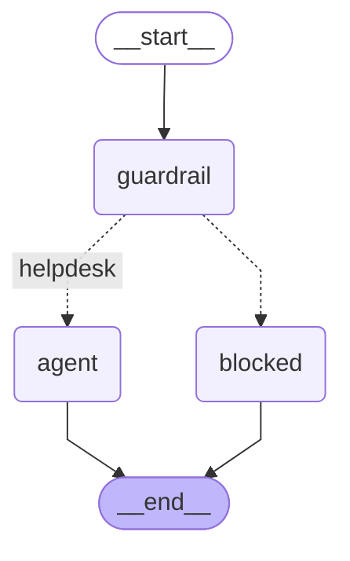
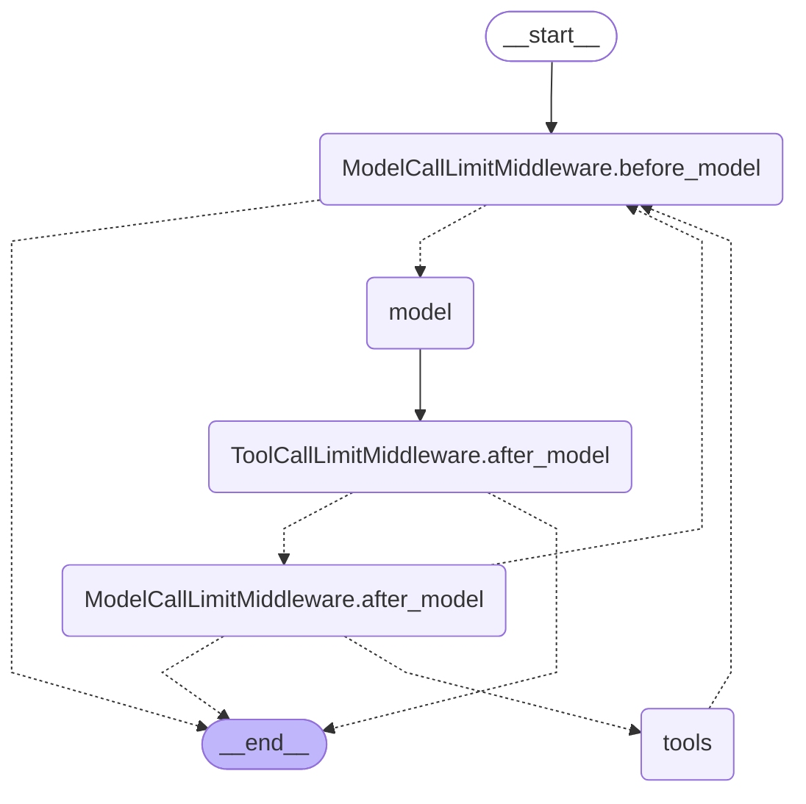

# Agent graph

## Request flow

This is the actual compiled outer LangGraph workflow. Its guardrail node
conditionally routes to the existing ReAct graph or a static-response node.
The outer graph has checkpointing disabled; only accepted ReAct turns persist. The classifier has no ticket tools. Its
blocked reply is application-owned. Blocked turns do not change conversation
history or create checkpoints; the intent appears only in diagnostic traces.
A provider refusal can invoke one reserve classifier inside the guardrail node;
exhausted classification failure stops with a technical error. This does not
change the graph topology or grant tools to either classifier.
MCP and the mock independently enforce live user authorization. A repeated
invalid argument or another terminal tool failure ends tool execution; the
model can still explain the failure. One changed-argument correction is allowed.

## Exact compiled graph

The following Mermaid was exported using `build_agent(...).get_graph().draw_mermaid()`
with the same middleware and initial discovery utility as `AgentService`.
An uninvoked local model and in-memory checkpointer were used only to compile
its structure. This export made no provider or MCP requests. The checkpointer
implementation does not change the graph topology; runtime history uses SQLite.

Dashed edges are conditional routes; solid edges are unconditional. The call
limit middleware contributes visible nodes. Model/tool wrapper middleware
(context preparation, tracing, dynamic MCP capabilities, and argument validation)
executes around the displayed model/tools and is not a separate graph node.
The input guardrail is a node of the outer workflow shown above.
It is outside the nested compiled ReAct graph shown in this section.
The current agent exposes read tools only; conversational approved writes are
not represented as implemented.

Sources: `backend/src/helpdesk/agent/graph.py`,
`backend/src/helpdesk/agent/workflow.py`,
`backend/src/helpdesk/agent/service.py`, and
`backend/src/helpdesk/agent/guardrails/input.py`.

Raw exports: [compiled graph](agent-compiled.mmd) and
[service flow](agent-request-flow.mmd).
